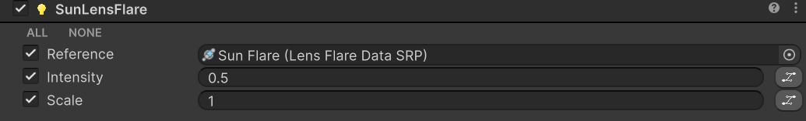

# Lighting

## Sun

<figure><figcaption></figcaption></figure>

Controls the sun light. Set the color, intensity, shadow settings, and angle options

<table><thead><tr><th width="128.3333740234375">Name</th><th width="101.6666259765625">Type<select><option value="ohaqqN1Yesqr" label="color" color="blue"></option><option value="RVqHPbO5fGTv" label="float" color="blue"></option><option value="8JX7TqvmW1aO" label="select" color="blue"></option><option value="7yfJFUCrfbFF" label="bool" color="blue"></option></select></th><th>Description</th></tr></thead><tbody><tr><td>lightColor</td><td>color</td><td>Sets the color of the sun light at a certain time. Starts and ends at midnight.</td></tr><tr><td>lightIntensity</td><td>float</td><td>Sets the intensity of the sun light at a certain time. Starts and ends at midnight.</td></tr><tr><td>shadowType</td><td>select</td><td>Determines the type of shadows used for this light.</td></tr><tr><td>shadowIntensity</td><td>float</td><td>Set the intensity of the sun light shadows</td></tr></tbody></table>

## Sun Cloud Shadows

<table><thead><tr><th width="128.3333740234375">Name</th><th width="101.6666259765625">Type<select><option value="RVqHPbO5fGTv" label="float" color="blue"></option></select></th><th>Description</th></tr></thead><tbody><tr><td>resolution</td><td>float</td><td>Sets the resolution of the cloud shadow cookie</td></tr><tr><td>size</td><td>float</td><td>Sets the size of the cloud shadow cookie</td></tr><tr><td>steps</td><td>float</td><td>Sets the number of steps used when raymarching the cloud shadow</td></tr><tr><td>blurRadius</td><td>float</td><td>Sets the radius of the cloud blurring</td></tr><tr><td>intensity</td><td>float</td><td>Sets the intensity of the shadows</td></tr></tbody></table>

## Sun Lens Flare

<figure><figcaption></figcaption></figure>

<table><thead><tr><th width="128.3333740234375">Name</th><th width="101.6666259765625">Type<select><option value="ohaqqN1Yesqr" label="color" color="blue"></option><option value="RVqHPbO5fGTv" label="float" color="blue"></option><option value="8JX7TqvmW1aO" label="select" color="blue"></option><option value="7yfJFUCrfbFF" label="bool" color="blue"></option><option value="Q0we15xaqlYW" label="LensFlareDataSRP" color="blue"></option></select></th><th>Description</th></tr></thead><tbody><tr><td>reference</td><td>LensFlareDataSRP</td><td>Sets the flare used for the sun at a certain time. Starts and ends at midnight.</td></tr><tr><td>intensity</td><td>float</td><td>Sets the intensity of the sun flare at a certain time. Starts and ends at midnight.</td></tr><tr><td>scale</td><td>float</td><td>Sets the scale of the sun flare at a certain time. Starts and ends at midnight.</td></tr></tbody></table>

## Moon

<figure><figcaption></figcaption></figure>

Controls the moon light. Set the color, intensity, shadow settings, and angle options

<table><thead><tr><th width="128.3333740234375">Name</th><th width="101.6666259765625">Type<select><option value="ohaqqN1Yesqr" label="color" color="blue"></option><option value="RVqHPbO5fGTv" label="float" color="blue"></option><option value="8JX7TqvmW1aO" label="select" color="blue"></option><option value="7yfJFUCrfbFF" label="bool" color="blue"></option></select></th><th>Description</th></tr></thead><tbody><tr><td>lightColor</td><td>color</td><td>Sets the color of the moon light at a certain time. Starts and ends at midnight.</td></tr><tr><td>lightIntensity</td><td>float</td><td>Sets the intensity of the moon light at a certain time. Starts and ends at midnight.</td></tr><tr><td>shadowType</td><td>select</td><td>Determines the method used for the ambient lighting.</td></tr><tr><td>shadowIntensity</td><td>float</td><td>Set the intensity of the moon light shadows</td></tr></tbody></table>

## Moon Lens Flare

<figure><figcaption></figcaption></figure>

<table><thead><tr><th width="128.3333740234375">Name</th><th width="101.6666259765625">Type<select><option value="ohaqqN1Yesqr" label="color" color="blue"></option><option value="RVqHPbO5fGTv" label="float" color="blue"></option><option value="8JX7TqvmW1aO" label="select" color="blue"></option><option value="7yfJFUCrfbFF" label="bool" color="blue"></option><option value="Q0we15xaqlYW" label="LensFlareDataSRP" color="blue"></option></select></th><th>Description</th></tr></thead><tbody><tr><td>reference</td><td>LensFlareDataSRP</td><td>Sets the flare used for the moon at a certain time. Starts and ends at midnight.</td></tr><tr><td>intensity</td><td>float</td><td>Sets the intensity of the sun flare at a certain time. Starts and ends at midnight.</td></tr><tr><td>scale</td><td>float</td><td>Sets the scale of the sun flare at a certain time. Starts and ends at midnight.</td></tr></tbody></table>

## Ambient

<figure><figcaption></figcaption></figure>

Sets the ambient lighting color, mode and intensity.

> Ambient light, also known as diffuse environmental light, is light that is present all around the Scene and doesn’t come from any specific source object. It can be an important contributor to overall Scene illumination.
>
> [Unity Documentation](https://docs.unity3d.com/6000.5/Documentation/Manual/lighting-ambient-light.html)

<table><thead><tr><th width="128.3333740234375">Name</th><th width="101.6666259765625">Type<select><option value="ohaqqN1Yesqr" label="color" color="blue"></option><option value="RVqHPbO5fGTv" label="float" color="blue"></option><option value="8JX7TqvmW1aO" label="select" color="blue"></option><option value="7yfJFUCrfbFF" label="bool" color="blue"></option></select></th><th>Description</th></tr></thead><tbody><tr><td>ambientMode</td><td>select</td><td>Determines the method used for the ambient lighting.</td></tr><tr><td>zenithColor</td><td>color</td><td>Sets the color of the sun light at a certain time. Starts and ends at midnight.</td></tr><tr><td>horizonColor</td><td>color</td><td>Sets the color of the horizon (or middle) of the skybox at a certain time. Starts and ends at midnight.</td></tr><tr><td>groundColor</td><td>color</td><td>Sets the color of the ground (or bottom) of the skybox at a certain time. Starts and ends at midnight.</td></tr><tr><td>intensity</td><td>float</td><td>Sets the intensity of the ambient lighting.</td></tr></tbody></table>
